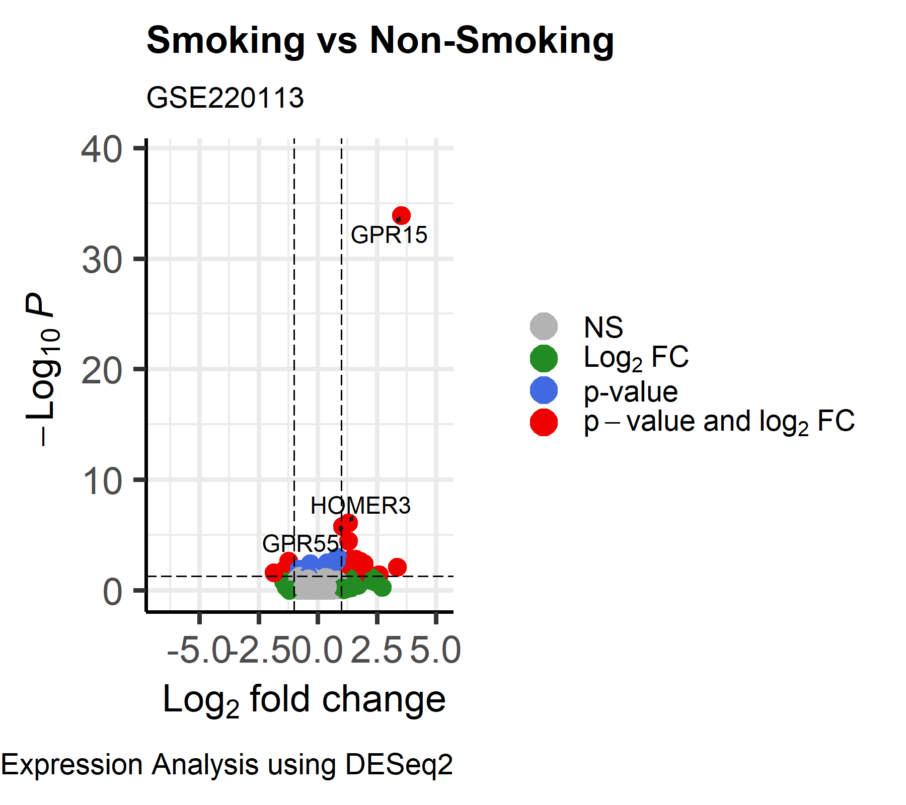
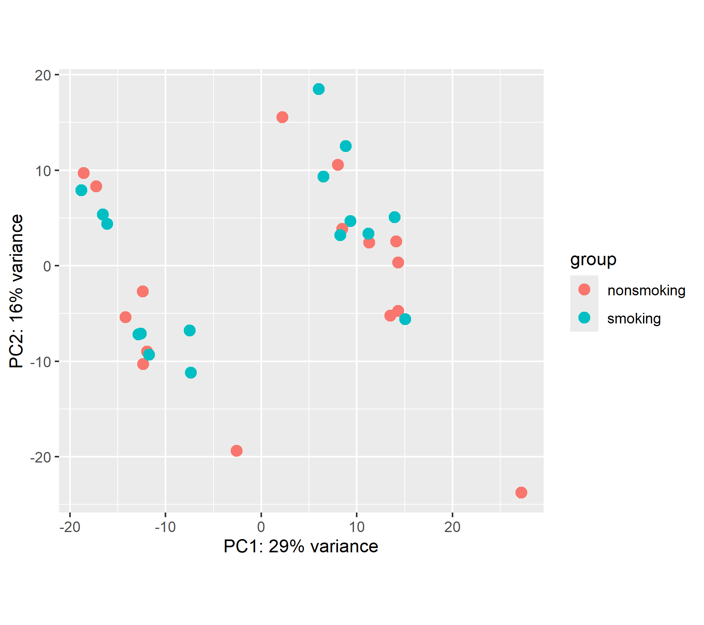
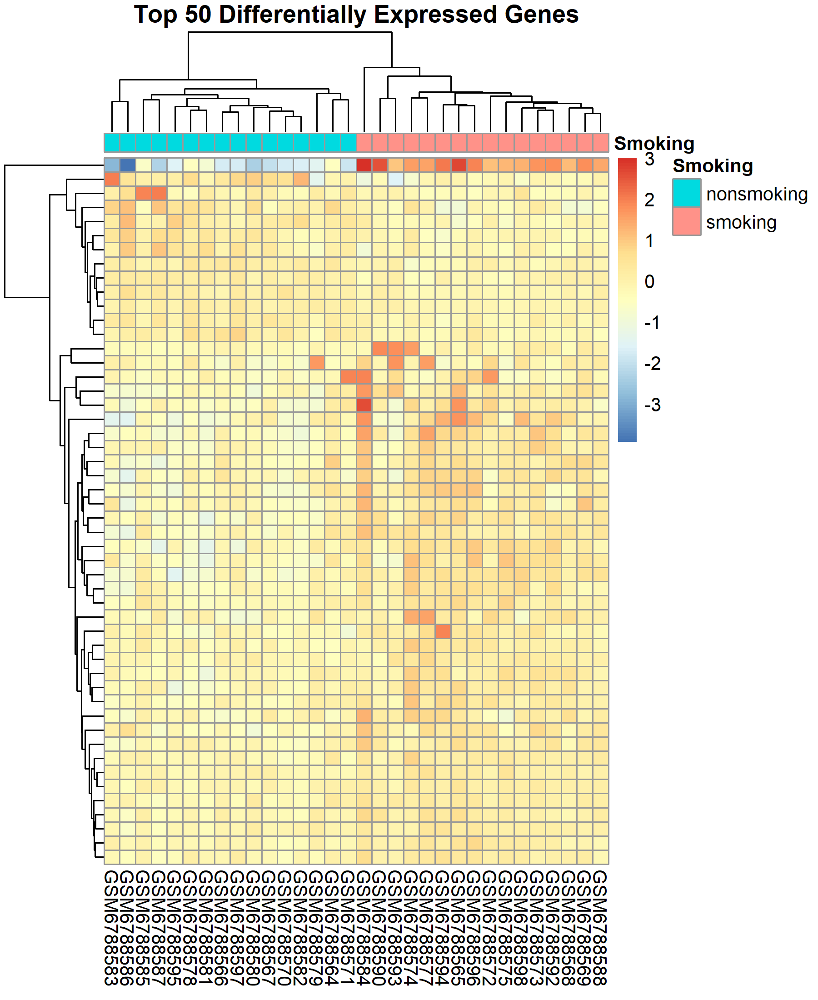

# Differential Gene Expression Analysis of Smoking vs Non-Smoking Using DESeq2

## Project Overview

This project presents a complete RNA sequencing (RNA-seq) differential gene expression analysis using the **DESeq2** package in **R**. The analysis investigates transcriptional differences between **smokers** and **non-smokers** using the publicly available **GSE220113** dataset from the NCBI Gene Expression Omnibus (GEO).

The workflow includes data preparation, differential expression analysis, visualization, gene annotation, and Gene Ontology (GO) enrichment analysis to identify biological processes associated with cigarette smoking.

---

## Dataset Information

**GEO Accession:** GSE220113

**Title:**  
*Effect of cigarette smoking on gene expression of peripheral blood B cells and on transcriptome changes by naïve-to-memory B cell shift*

**Organism:** Homo sapiens

**Experiment Type:** Expression profiling by high-throughput sequencing (RNA-seq)

**Platform:** Illumina NovaSeq 6000 (GPL24676)

**Original Study:**  
Peripheral blood CD19+ B cells were isolated from healthy adult smokers and non-smokers. RNA sequencing was performed to investigate smoking-associated transcriptional changes and their relationship to B-cell subtype shifts.

**Overall Experimental Design**

- Smoking group
- Non-smoking group

The original GEO study contains **35 samples**.

The NCBI-generated RNA-seq count matrix used in this project contains **32 samples**, consisting of:

- **16 Smokers**
- **16 Non-smokers**

These samples were used for all downstream analyses.

---

## Objectives

The objectives of this project were to:

- Import and prepare RNA-seq count data
- Construct a DESeq2 dataset
- Normalize raw read counts
- Perform differential gene expression analysis
- Identify significantly differentially expressed genes (DEGs)
- Visualize gene expression patterns
- Annotate significant genes
- Perform Gene Ontology enrichment analysis
- Interpret biological functions associated with smoking

---

# Analysis Workflow

```text
Raw RNA-seq Count Matrix
            │
            ▼
Metadata Preparation
            │
            ▼
DESeq2 Dataset Construction
            │
            ▼
Gene Filtering
            │
            ▼
Normalization
            │
            ▼
Differential Expression Analysis
            │
            ▼
Visualization
            │
            ▼
Gene Annotation
            │
            ▼
GO Enrichment Analysis
            │
            ▼
Biological Interpretation
```

---

# Repository Structure

```text
RNAseq-DESeq2-Smoking/

│
├── data/
│   ├── GSE220113_raw_counts_GRCh38.p13_NCBI.tsv
│   ├── GSE220113_series_matrix.txt
│   └── Human.GRCh38.p13.annot.tsv
│
├── scripts/
│   ├── 01_data_preparation.R
│   ├── 02_deseq2_analysis.R
│   ├── 03_visualization.R
│   ├── 04_gene_annotation.R
│   ├── 05_functional_enrichment.R
│   └── 06_volcano_plot.R
│
├── figures/
│   ├── MA_Plot.png
│   ├── PCA_Plot.png
│   ├── Sample_Distance_Heatmap.png
│   ├── Top50_Gene_Heatmap.png
│   ├── Volcano_Plot.png
│   ├── GO_Dotplot.png
│   ├── GO_Barplot.png
│   ├── GO_Enrichment_Map.png
│   └── GO_Gene_Concept_Network.png
│
├── results/
│   ├── DEG_results.csv
│   ├── Significant_Genes.csv
│   ├── DEG_results_Annotated.csv
│   ├── Significant_Genes_Annotated.csv
│   ├── GO_Biological_Process.csv
│   ├── GO_Molecular_Function.csv
│   ├── GO_Cellular_Component.csv
│   └── KEGG_Pathways.csv
│
├── sessionInfo.txt
├── README.md
└── LICENSE
```

---

# Software

- R
- RStudio

## R Packages

- DESeq2
- AnnotationDbi
- org.Hs.eg.db
- EnhancedVolcano
- clusterProfiler
- enrichplot
- pheatmap
- ggplot2
- matrixStats

---

# Analysis Scripts

| Script | Description |
|---------|-------------|
| 01_data_preparation.R | Import count matrix and prepare sample metadata |
| 02_deseq2_analysis.R | Differential expression analysis using DESeq2 |
| 03_visualization.R | MA plot, PCA, heatmaps, and expression visualization |
| 04_gene_annotation.R | Annotation of differentially expressed genes |
| 05_functional_enrichment.R | GO and KEGG enrichment analysis |
| 06_volcano_plot.R | Publication-quality volcano plot |

---

# Differential Expression Results

### Samples

- Total GEO samples: **35**
- Samples analyzed: **32**
- Smokers: **16**
- Non-smokers: **16**

### Genes

- Initial genes: **39,376**
- Genes after filtering: **27,065**

### Significant Differentially Expressed Genes

Using:

- Adjusted p-value < 0.05
- |Log2 Fold Change| > 1

**68 genes** were identified as significantly differentially expressed.

Among the most significant genes were:

- GPR15
- HOMER3
- GPR55
- ARHGAP6
- MGAT3
- NCALD

GPR15 showed the strongest differential expression and is a well-established smoking-associated biomarker.

---

# Functional Enrichment Analysis

Gene Ontology enrichment analysis identified significant enrichment of immune-related biological processes, including:

- Regulation of immune effector process
- Leukocyte activation
- Leukocyte-mediated immunity
- Lymphocyte-mediated immunity
- Cell activation involved in immune response

These findings indicate that cigarette smoking is associated with altered immune function in peripheral blood B cells.

---

# KEGG Pathway Analysis

KEGG over-representation analysis was performed using clusterProfiler.

No pathways met the selected significance threshold after multiple testing correction. This result suggests that although individual genes were significantly altered, no KEGG pathways reached statistical significance under the analysis criteria.

---

# Figures

The **figures/** directory contains:

- MA Plot
- PCA Plot
- Sample Distance Heatmap
- Top 50 Differentially Expressed Gene Heatmap
- Volcano Plot
- GO Dot Plot
- GO Bar Plot
- GO Enrichment Map
- GO Gene–Concept Network

Example (display images in GitHub):

```markdown
## Volcano Plot



## PCA Plot



## Top 50 Heatmap



## GO Enrichment Map


```

---

# Reproducing the Analysis

1. Clone this repository.

```bash
git clone https://github.com/samreenpatel/DESeq2-Smoking.git 
```

2. Download the GSE220113 dataset from GEO.

3. Place the downloaded files inside the **data/** directory.

4. Run the scripts in the following order:

```text
01_data_preparation.R

02_deseq2_analysis.R

03_visualization.R

04_gene_annotation.R

05_functional_enrichment.R

06_volcano_plot.R
```

---

# Key Findings

- Differential expression analysis identified **68 significant genes** between smokers and non-smokers.
- **GPR15** was the most strongly differentially expressed gene, consistent with previous studies identifying it as a smoking-associated biomarker.
- Gene Ontology enrichment highlighted significant immune-related biological processes, suggesting that cigarette smoking influences immune regulation in peripheral blood B cells.
- No statistically significant KEGG pathways were identified under the selected analysis criteria.

---

# References

Love MI, Huber W, Anders S. *Moderated estimation of fold change and dispersion for RNA-seq data with DESeq2.* Genome Biology. 2014.

Yu G, Wang LG, Han Y, He QY. *clusterProfiler: an R package for comparing biological themes among gene clusters.* OMICS. 2012.

Wang X, Campbell MR, Cho HY, Pittman GS, et al. *Epigenomic profiling of isolated blood cell types reveals highly specific B cell smoking signatures and links to disease risk.* Clinical Epigenetics. 2023.

NCBI Gene Expression Omnibus (GEO). **GSE220113**.

---
